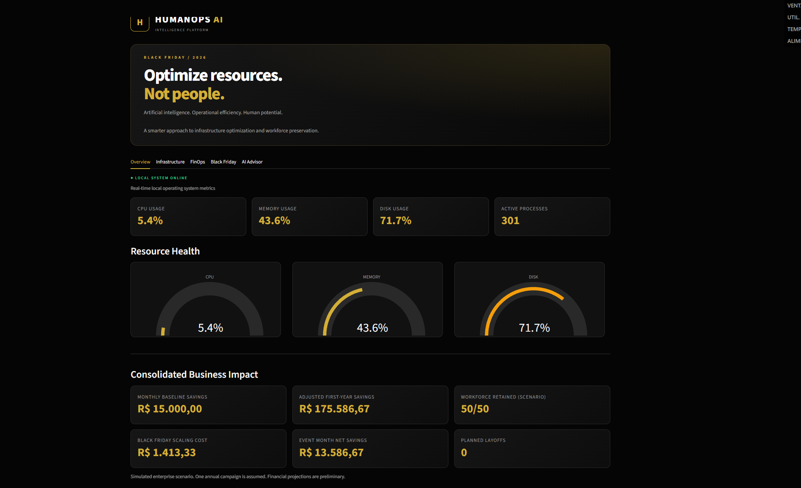
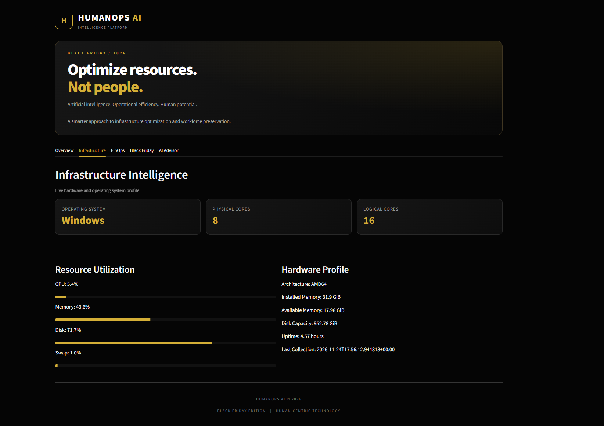
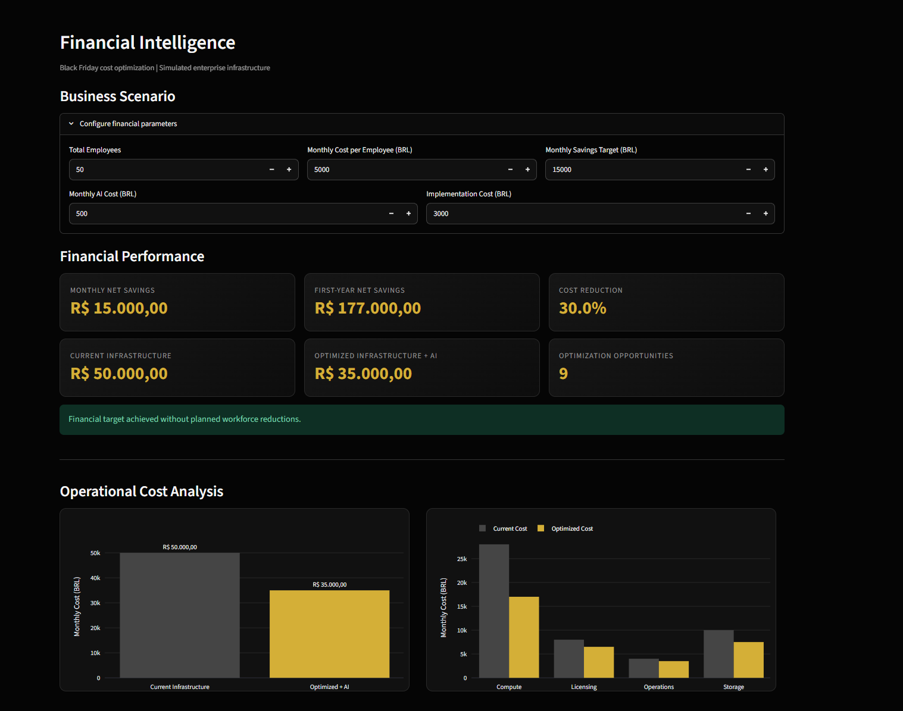
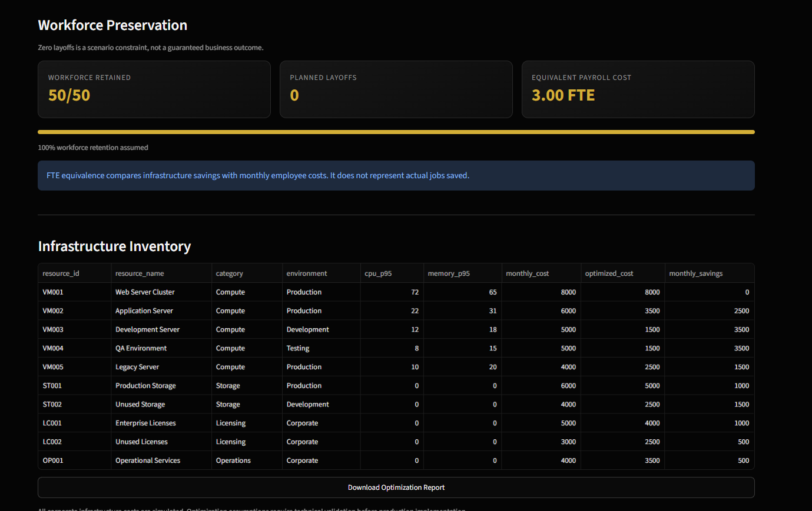
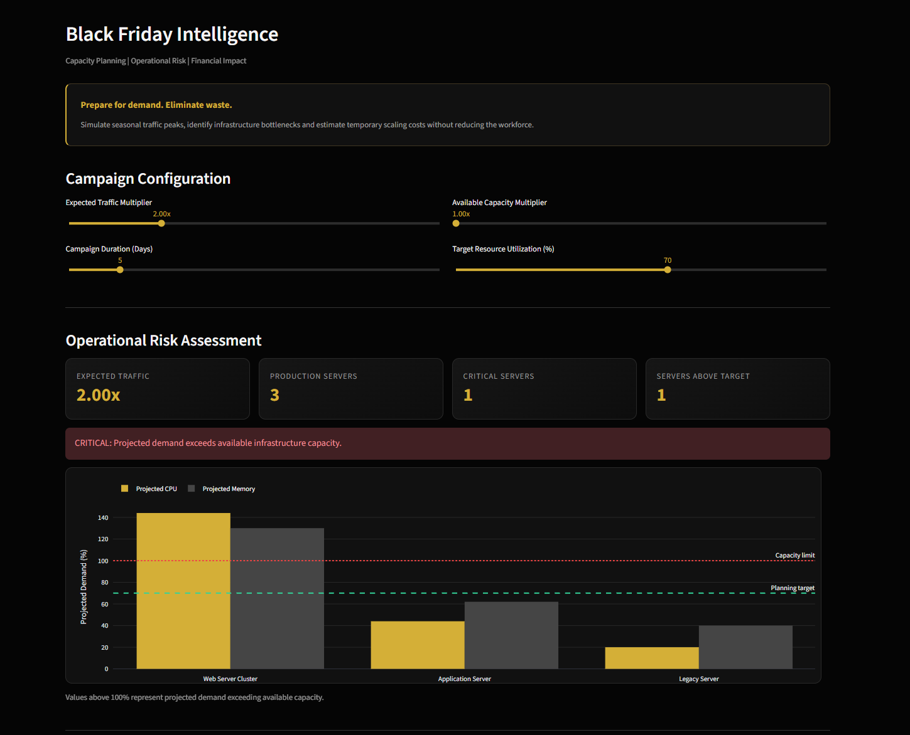
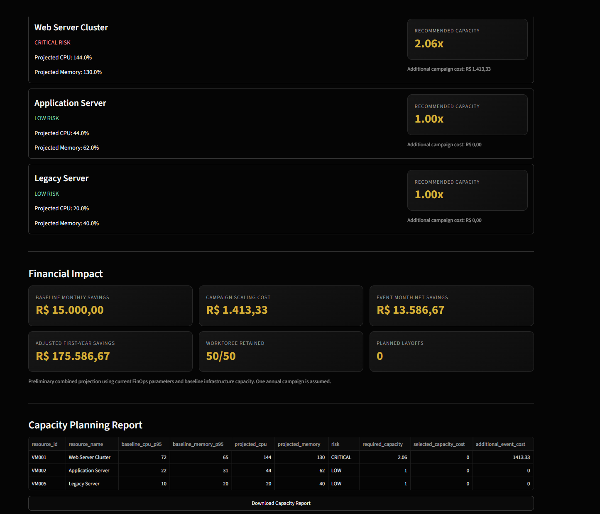
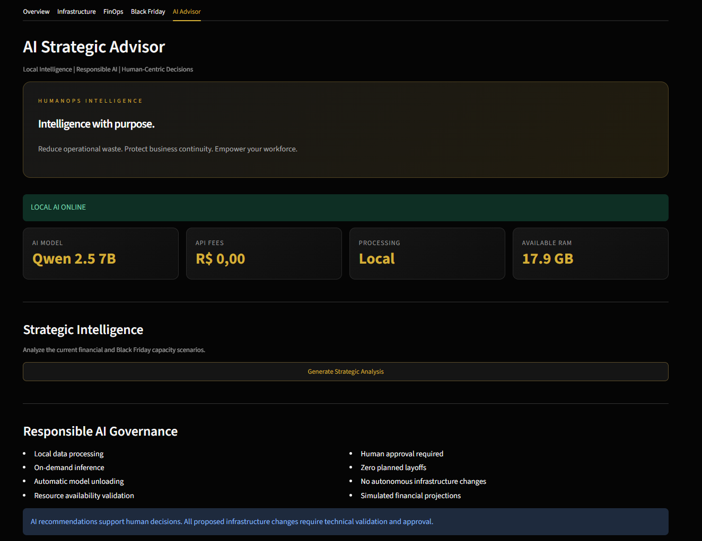
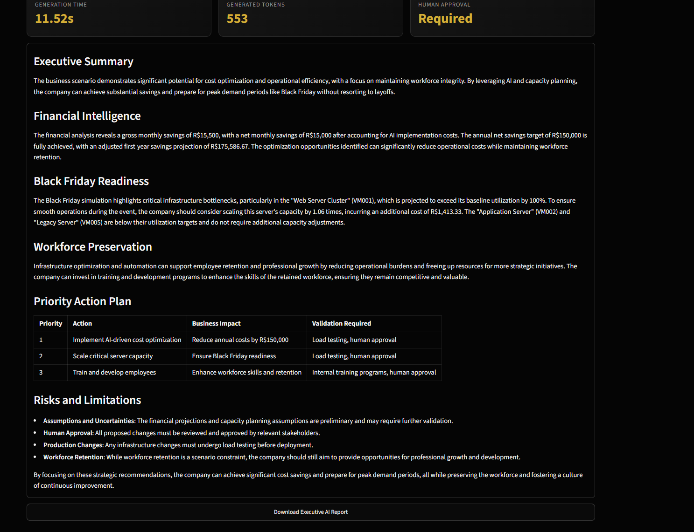
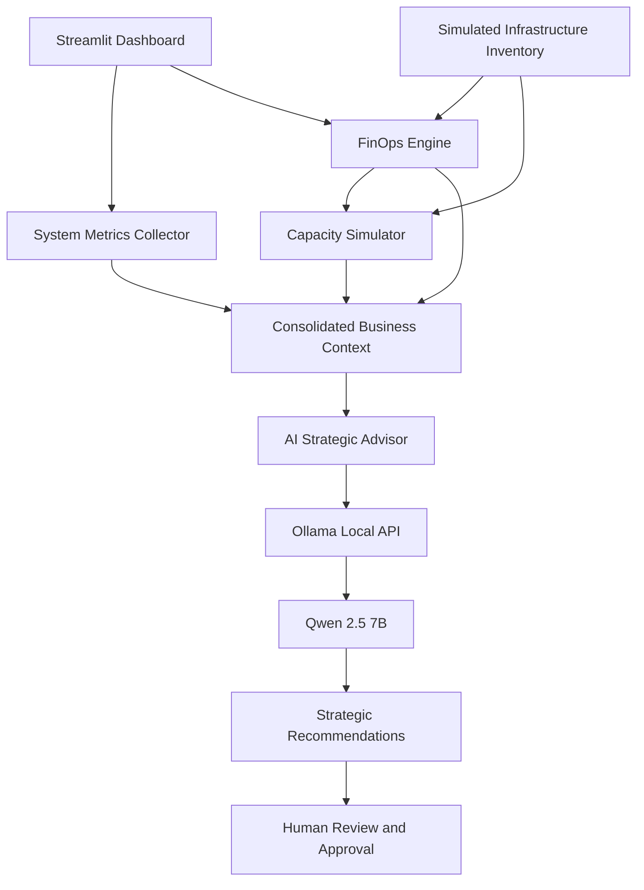

<div align="center">

# HUMANOPS AI

### BLACK FRIDAY EDITION — 2026

**Optimize resources. Not people.**

*Artificial Intelligence. Operational Efficiency. Human Potential.*


</div>

---

## Project Overview

HumanOps AI is a human-centric infrastructure intelligence
platform designed to explore how operational efficiency,
financial optimization and artificial intelligence can support
business sustainability and workforce preservation.

The platform combines real-time system monitoring, FinOps
analysis, seasonal capacity planning and locally hosted
artificial intelligence within a unified dashboard.

Its central principle is simple:

> Before reducing people, identify opportunities to reduce
> infrastructure waste.

## The Business Problem

Organizations frequently face pressure to reduce operational
expenses while maintaining service availability, productivity
and competitiveness.

During high-demand periods such as Black Friday, this challenge
becomes even more significant.

HumanOps AI explores an alternative approach through:

- Infrastructure cost optimization.
- Identification of underutilized resources.
- Data-driven capacity planning.
- Responsible artificial intelligence.
- Human-centered operational decisions.

## Key Features

### Infrastructure Intelligence

- Real-time CPU, memory, disk and swap monitoring.
- Operating system and hardware profiling.
- Physical and logical CPU core identification.
- Process monitoring.
- System uptime tracking.
- Interactive resource utilization dashboards.

### FinOps Intelligence

- Simulated enterprise infrastructure inventory.
- Infrastructure cost comparison.
- Monthly and annual savings projections.
- Configurable workforce and operational parameters.
- AI operating cost estimation.
- Implementation cost analysis.
- Financial target validation.
- Workforce preservation scenario modeling.

### Black Friday Capacity Planning

- Configurable demand multiplier.
- Configurable infrastructure capacity.
- Seasonal campaign duration.
- CPU and memory utilization projections.
- Infrastructure risk classification.
- Temporary capacity cost estimation.
- Consolidated financial impact analysis.

### AI Strategic Advisor

- Local inference using Ollama and Qwen 2.5 7B.
- Resource-aware AI execution.
- Available memory validation.
- On-demand model loading.
- Automatic model unloading after inference.
- Strategic recommendations based on business scenarios.
- Downloadable AI-generated reports.
- Human approval requirements.

### Software Quality

- Automated testing with Pytest.
- Unit and integration tests.
- Streamlit application testing.
- Mocked AI service integration.
- Code coverage reporting.
- GitHub Actions CI configuration.
- Windows and Linux CI targets.

## Business Impact Simulation

The default demonstration uses a fictional enterprise
infrastructure inventory.

| Financial Indicator | Simulated Result |
|---|---:|
| Current Monthly Infrastructure Cost | BRL 50,000.00 |
| Optimized Infrastructure Cost | BRL 34,500.00 |
| Monthly AI Operating Cost | BRL 500.00 |
| Monthly Net Savings | BRL 15,000.00 |
| Operational Cost Reduction | 30% |
| Implementation Cost | BRL 3,000.00 |
| First-Year Net Savings | BRL 177,000.00 |
| Black Friday Scaling Cost | BRL 1,413.33 |
| Event Month Net Savings | BRL 13,586.67 |
| Adjusted First-Year Savings | BRL 175,586.67 |
| Workforce Size | 50 |
| Planned Layoffs | 0 |
| Workforce Retention Constraint | 100% |

These values represent simulated projections, not actual
financial results or guaranteed workforce outcomes.

The consolidated projection assumes one annual campaign.

## Application Modules

| Module | Responsibility |
|---|---|
| Overview | Consolidated operational and financial indicators |
| Infrastructure | Local hardware and operating system monitoring |
| FinOps | Financial optimization and savings analysis |
| Black Friday | Seasonal demand and capacity planning |
| AI Advisor | Local AI-powered strategic recommendations |

## Application Screenshots

A visual walkthrough of the HumanOps AI platform.

### Dashboard Preview 01

<div align="center">
  
</div>

---

### Dashboard Preview 02

<div align="center">
  
</div>

---

---

### Dashboard Preview 04

<div align="center">
  
</div>

---

### Dashboard Preview 05

<div align="center">
  
</div>

---

### Dashboard Preview 06

<div align="center">
  
</div>

---

### Dashboard Preview 07

<div align="center">
  
</div>

---

### Dashboard Preview 08

<div align="center">
  
</div>

---

### Dashboard Preview 09

<div align="center">
  
</div>

---

## System Architecture



## Technology Stack

| Technology | Purpose |
|---|---|
| Python | Application and business logic |
| Streamlit | Interactive dashboard |
| Pandas | Data processing |
| Plotly | Interactive visualizations |
| Psutil | System resource monitoring |
| Requests | Local AI API communication |
| Ollama | Local AI inference |
| Qwen 2.5 7B | Language model |
| Pytest | Automated testing |
| Pytest-Cov | Code coverage |
| GitHub Actions | Continuous integration |
| CSS | Custom visual design |

## Project Structure

```text
humanops-ai/
├── .github/
│   └── workflows/
│       └── ci.yml
├── .streamlit/
│   └── config.toml
├── assets/
│   └── style.css
├── collectors/
│   └── system_metrics.py
├── data/
│   └── infrastructure.csv
├── services/
│   ├── ai_optimizer.py
│   ├── cost_analyzer.py
│   └── scenario_simulator.py
├── views/
│   ├── ai_dashboard.py
│   ├── black_friday_dashboard.py
│   └── finops_dashboard.py
├── tests/
│   ├── test_ai_optimizer.py
│   ├── test_business_integration.py
│   ├── test_cost_analyzer.py
│   ├── test_scenario_simulator.py
│   └── test_system_metrics.py
├── .coveragerc
├── .env.example
├── .gitignore
├── app.py
├── requirements.txt
├── requirements-dev.txt
├── README.md
└── ROADMAP.md
```

## Installation

### Prerequisites

- Python 3.14
- Git
- Ollama (optional for non-AI features)
- Qwen 2.5 7B model for AI recommendations
- At least 10 GiB of available RAM for AI inference,
  according to the application's resource validation policy

### Clone the Repository

Repository access is required while the project is private.

```bash
git clone https://github.com/izabelle-nascimento/humanops-ai.git
cd humanops-ai
```

### Create a Virtual Environment

Windows:

```powershell
python -m venv .venv
.\.venv\Scripts\Activate.ps1
```

Linux:

```bash
python -m venv .venv
source .venv/bin/activate
```

### Install Dependencies

```bash
python -m pip install -r requirements.txt
```

### Configure Local AI

Install Ollama from:

https://ollama.com

Download the model:

```bash
ollama pull qwen2.5:7b
```

Ensure the Ollama service is running locally.

The application uses the following local endpoint:

```text
http://localhost:11434
```

### Run the Application

```bash
python -m streamlit run app.py
```

Open:

```text
http://localhost:8501
```

The infrastructure, FinOps and capacity planning modules
can operate without an available AI model.

## Automated Testing

Install development dependencies:

```bash
python -m pip install -r requirements-dev.txt
```

Execute the test suite:

```bash
python -m pytest tests/ -v
```

Generate a code coverage report:

```bash
python -m pytest tests/ --cov --cov-config=.coveragerc --cov-report=term-missing --cov-report=html
```

The test suite covers:

- System metrics collection.
- Financial calculations.
- Invalid input handling.
- Capacity planning scenarios.
- AI availability and resource validation.
- Mocked AI inference.
- Dashboard synchronization.
- Business scenario integration.

AI tests use mocked responses and do not require
loading the language model.

## Continuous Integration

The GitHub Actions workflow is configured to execute:

1. Python environment configuration.
2. Dependency installation.
3. Dependency validation.
4. Python syntax validation.
5. Automated tests.
6. Code coverage generation.
7. Quality assurance artifact publication.

The workflow targets Windows and Ubuntu environments.

Remote CI results must be validated after publication.

## Responsible AI and Governance

HumanOps AI follows a human-in-the-loop approach.

- AI recommendations require human review.
- No autonomous infrastructure changes are performed.
- Employee layoffs are not recommended by design.
- Financial calculations are performed by Python.
- AI-generated recommendations are advisory.
- Local inference avoids external LLM API fees.
- Infrastructure changes require technical validation.
- Workforce retention is a scenario constraint,
  not a guaranteed outcome.

## Limitations and Assumptions

HumanOps AI is a portfolio proof of concept.

- Enterprise infrastructure data is simulated.
- Local system metrics represent the host computer,
  not an enterprise production environment.
- Capacity projections use linear scaling assumptions.
- Temporary infrastructure pricing is simplified.
- FinOps optimization and seasonal capacity requirements
  are not fully aligned at the resource level.
- Financial projections require real-world validation.
- AI-generated recommendations may contain inaccuracies.
- Local AI execution still incurs hardware and energy costs.
- No production load testing has been performed.

## Future Development

See [ROADMAP.md](ROADMAP.md) for planned improvements.

## Author

**Izabelle Nascimento**

Infrastructure Automation | Python | FinOps | DevOps |
Artificial Intelligence

GitHub: https://github.com/izabelle-nascimento

---

<div align="center">

### HUMANOPS AI

**Technology should empower people, not replace them.**

*Optimize resources. Not people.*

</div>
